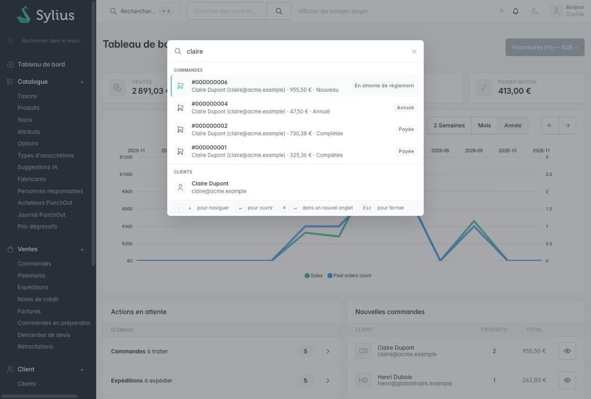

# Sylius Command Palette Plugin

> English: [README.md](README.md) <!-- vitrine:lang -->

[](https://github.com/thibmonier/sylius-command-palette-plugin/actions/workflows/build.yaml)
[](LICENSE)

**Une palette de commandes (Ctrl+K / ⌘K) pour le back-office de Sylius 2 : retrouvez n'importe
quelle commande, n'importe quel client, produit, promotion ou page d'administration, depuis
n'importe où.**

L'administration de Sylius 2 n'a pas de recherche globale : le champ de la barre de navigation
ne cherche que des produits, le champ de la barre latérale ne fait que filtrer les entrées du
menu, et il n'existe aucun raccourci clavier. Retrouver « la commande 1042 » ou « le client qui
a appelé » oblige à ouvrir la bonne grille et à la filtrer d'abord.

Ce plugin ajoute à chaque page d'administration une boîte de dialogue de recherche pensée pour
le clavier, gratuite et open source.

## Fonctionnalités

| Besoin | Ce que fait le plugin |
|---|---|
| Ouvrir une commande à partir de son numéro | **Commandes** : correspondance exacte du numéro en premier, saisi sous la forme `1042`, `#1042` ou `000001042`, puis les dernières commandes des clients dont l'e-mail ou le nom de famille commence par la requête. Sous-titre : client, total, état ; badge : état du paiement. Les paniers ne sont jamais listés. |
| Trouver un client | **Clients** : début de l'e-mail, du prénom, du nom de famille ou du numéro de téléphone, et « prénom nom » (`john do`). Sous-titre : e-mail et groupe. |
| Aller à un produit ou à une variante | **Produits** : nom dans la langue de l'administrateur (contient) ou code (début), puis **variantes** par code, avec un lien vers la page d'édition du produit ou de la variante. Les produits désactivés sont signalés. |
| Modifier une promotion | **Promotions** par nom ou code, **coupons** par code (avec un lien vers la page des coupons de leur promotion). |
| Naviguer sans la barre latérale | **Pages** : toutes les pages du menu principal de l'administration (y compris les entrées ajoutées par d'autres plugins), avec leur section, et **actions** (nouveau produit, catégorie, client, promotion…). Filtrées instantanément dans le navigateur dès 1 caractère. |
| Chercher d'autres données | **Vos propres sources** : taguez un service qui implémente `SearchProviderInterface`. |

Sont également inclus : la navigation au clavier, une boîte de dialogue accessible (modèle
combobox / listbox, piège à focus, focus restauré à la fermeture), des thèmes clair et sombre,
des traductions en anglais, français, allemand, espagnol, italien, néerlandais et polonais,
aucune étape de build et aucune dépendance JavaScript.

## Captures d'écran




*Palette de commandes (Cmd+K) pour « claire » : ses dernières commandes avec leur statut, puis le client*

## Prérequis

| | Version |
|---|---|
| PHP | 8.2+ |
| Sylius | 2.2, 2.3 |
| Symfony | 7.4, 8.0 |

## Installation

1. Installez le paquet :

    ```bash
    composer require tmonier/sylius-command-palette-plugin
    ```

2. Enregistrez le bundle dans `config/bundles.php` (Symfony Flex le fait automatiquement dès qu'une recette existe) :

    ```php
    Tmonier\SyliusCommandPalettePlugin\TmonierSyliusCommandPalettePlugin::class => ['all' => true],
    ```

3. Importez la configuration dans `config/packages/tmonier_sylius_command_palette.yaml` :

    ```yaml
    imports:
        - { resource: "@TmonierSyliusCommandPalettePlugin/config/config.yaml" }
    ```

4. Importez la route d'administration dans `config/routes/tmonier_sylius_command_palette.yaml` :

    ```yaml
    tmonier_sylius_command_palette:
        resource: "@TmonierSyliusCommandPalettePlugin/config/routes.yaml"
    ```

5. Installez les assets (un fichier JavaScript et un fichier CSS, rien à compiler) :

    ```bash
    bin/console assets:install
    ```

Aucune migration : le plugin n'a pas de table.

## Configuration

```yaml
# config/packages/tmonier_sylius_command_palette.yaml
tmonier_sylius_command_palette:
    limit_per_group: 5      # results per group (1 to 50)
    icons: []               # extra UX Icons names used by your own providers
    providers:
        orders: true
        customers: true
        products: true      # products and variants
        promotions: true    # promotions and promotion coupons
        pages: true         # admin menu pages and "create" actions
    rate_limit:
        enabled: true       # set to false to disable (default: true, requires symfony/rate-limiter)
        per_admin: 120      # max requests per admin user (or per IP) per interval
        interval: '1 minute'
        cache_pool: cache.rate_limiter   # any PSR-6 pool; use a filesystem pool in tests
```

### Limitation de débit

Le point d'entrée de recherche exécute des requêtes DQL à chaque frappe. Le limiteur de débit
intégré (`symfony/rate-limiter` + `symfony/lock`) plafonne les requêtes à **120 par minute et
par administrateur** (selon l'identifiant de l'utilisateur ; repli sur l'IP du client si aucun
utilisateur n'est trouvé). Les requêtes qui dépassent la limite reçoivent une réponse JSON
`429 Too Many Requests` (`{"error": "too_many_requests"}`) avec un en-tête `Retry-After` (en
secondes).

Le limiteur de débit est activé par défaut et se désactive automatiquement si le paquet
`symfony/rate-limiter` n'est pas installé. Pour le désactiver explicitement :

```yaml
tmonier_sylius_command_palette:
    rate_limit:
        enabled: false
```

## Raccourcis clavier

| Touches | Action |
|---|---|
| <kbd>Ctrl</kbd>+<kbd>K</kbd> / <kbd>⌘</kbd>+<kbd>K</kbd> | Ouvrir / fermer la palette (de n'importe où, même dans un champ de formulaire) |
| <kbd>/</kbd> | Ouvrir la palette lorsque le focus n'est pas dans un champ de formulaire |
| <kbd>↑</kbd> <kbd>↓</kbd> | Se déplacer entre les résultats |
| <kbd>Enter</kbd> | Ouvrir le résultat sélectionné |
| <kbd>Ctrl</kbd>+<kbd>Enter</kbd> / <kbd>⌘</kbd>+<kbd>Enter</kbd> | Ouvrir le résultat sélectionné dans un nouvel onglet |
| <kbd>Esc</kbd> | Fermer la palette et revenir là où vous étiez |

Le bouton *Rechercher… ⌘K* de la barre de navigation l'ouvre aussi. Le champ de recherche de
produits de Sylius est conservé.

## Ajouter votre propre fournisseur

Implémentez `SearchProviderInterface` et taguez le service avec `tmonier_command_palette.provider`.
La priorité définit la position du groupe (fournisseurs intégrés : commandes 500, clients 400,
produits 300, promotions 200, coupons 100).

```php
namespace App\CommandPalette;

use Doctrine\ORM\EntityManagerInterface;
use Symfony\Component\Routing\Generator\UrlGeneratorInterface;
use Tmonier\SyliusCommandPalettePlugin\Search\LikePattern;
use Tmonier\SyliusCommandPalettePlugin\Search\SearchProviderInterface;
use Tmonier\SyliusCommandPalettePlugin\Search\SearchResult;

final class ShipmentSearchProvider implements SearchProviderInterface
{
    public function __construct(
        private EntityManagerInterface $entityManager,
        private UrlGeneratorInterface $urlGenerator,
    ) {
    }

    public function getKey(): string
    {
        return 'shipments'; // group label: translation "tmonier_command_palette.group.shipments"
    }

    /** $query is trimmed and 2 to 100 characters long. */
    public function search(string $query, int $limit): array
    {
        $rows = $this->entityManager->createQueryBuilder()
            ->select('s.id AS id', 's.tracking AS tracking', 'o.number AS number')
            ->from(\App\Entity\Shipping\Shipment::class, 's')
            ->innerJoin('s.order', 'o')
            ->andWhere(sprintf('LOWER(s.tracking) LIKE :prefix %s', LikePattern::DQL_ESCAPE))
            ->setParameter('prefix', LikePattern::prefix($query)) // escapes % and _
            ->setMaxResults($limit)
            ->getQuery()
            ->getArrayResult();

        return array_map(fn (array $row): SearchResult => new SearchResult(
            title: $row['tracking'],
            subtitle: '#' . $row['number'],
            url: $this->urlGenerator->generate('sylius_admin_shipment_index'),
            icon: 'tabler:truck',
        ), $rows);
    }
}
```

```yaml
# config/services.yaml
services:
    App\CommandPalette\ShipmentSearchProvider:
        arguments: ['@doctrine.orm.entity_manager', '@router']
        tags: [{ name: tmonier_command_palette.provider, priority: 150 }]

# config/packages/tmonier_sylius_command_palette.yaml
tmonier_sylius_command_palette:
    icons: ['tabler:truck']
```

```yaml
# translations/messages.en.yaml
tmonier_command_palette:
    group:
        shipments: Shipments
```

Recommandations :

- Liez chaque valeur saisie par l'utilisateur comme paramètre et échappez les jokers LIKE avec
  `LikePattern` (`escape()`, `prefix()`, `contains()`, utilisés avec `LikePattern::DQL_ESCAPE`).
- Sélectionnez des colonnes scalaires (une requête par groupe, pas de chargement différé par
  résultat) et respectez `$limit`.
- Retournez des URL de pages d'administration : le point d'entrée n'est accessible qu'aux
  administrateurs, mais c'est votre fournisseur qui décide de ce qu'il expose.
- Les icônes sont des noms [UX Icons](https://symfony.com/bundles/ux-icons/current/index.html)
  rendus une seule fois dans le gabarit : ajoutez à l'option `icons` celles qui ne sont pas
  utilisées par le menu d'administration (une icône inconnue est remplacée par une flèche).
- Une exception levée par un fournisseur est journalisée (canal `tmonier_command_palette`) et son
  groupe est ignoré ; les autres groupes sont tout de même renvoyés.

Les entrées de menu d'administration ajoutées via l'événement `sylius.menu.admin.main` (ou un
constructeur de menu) apparaissent automatiquement dans le groupe *Pages*.

## Personnalisation

Les parties d'administration sont ajoutées avec les [Twig Hooks](https://stack.sylius.com/twig-hooks/getting-started) :

| Hook | Contenu |
|---|---|
| `sylius_admin.common.component.navbar.menu` → `tmonier_command_palette` | Bouton *Rechercher… ⌘K* (avant la recherche de produits) |
| `sylius_admin.base#stylesheets` → `tmonier_command_palette` | Feuille de style |
| `sylius_admin.base#javascripts` → `tmonier_command_palette` | Boîte de dialogue, icônes et script (administrateurs uniquement) |

Les gabarits peuvent être surchargés dans `templates/bundles/TmonierSyliusCommandPalettePlugin/`.
Pour masquer le bouton de la barre de navigation tout en gardant les raccourcis :

```yaml
sylius_twig_hooks:
    hooks:
        'sylius_admin.common.component.navbar.menu':
            tmonier_command_palette:
                enabled: false
```

Le point d'entrée de recherche est `GET /admin/command-palette/search?q=…` (route
`tmonier_command_palette_admin_search`), qui renvoie
`{"query": "…", "groups": [{"key", "label", "results": [{"title", "subtitle", "url", "icon", "badge"}]}]}`.

## Fonctionnement

- **Recherche côté serveur** pour les commandes, les clients, les produits et les promotions :
  les requêtes sont temporisées (200 ms), la précédente est annulée, les requêtes de moins de 2
  caractères ne sont pas envoyées et les requêtes sont tronquées à 100 caractères (dans le
  navigateur et sur le serveur). Chaque fournisseur exécute une ou deux requêtes scalaires avec
  des paramètres liés, quel que soit le nombre de résultats.
- **Pages côté client** : le menu d'administration et les actions sont rendus une seule fois dans
  la page sous forme de JSON et filtrés dans le navigateur, ils apparaissent donc dès la
  première frappe.
- **JavaScript pur, sans build** : `command-palette.js` (une IIFE, sans dépendance) et
  `command-palette.css` sont installés par `assets:install` dans
  `public/bundles/tmoniersyliuscommandpaletteplugin/`. Chaque valeur est affichée avec
  `textContent` ; les icônes sont clonées à partir d'éléments `<template>` rendus par Twig.
- **Sécurité** : le point d'entrée est derrière le pare-feu d'administration
  (`ROLE_ADMINISTRATION_ACCESS`, vérifié à nouveau dans le contrôleur), les réponses sont
  `private, no-store`. Une session expirée affiche dans la palette un message
  « rechargez la page ».

## Limitations

- La correspondance utilise `LIKE` (début pour les codes, e-mails et noms, contient pour les
  noms de produits et de promotions), pas un index plein texte : sur de très gros catalogues,
  les recherches « contient » parcourent les tables de traduction. Branchez un fournisseur
  adossé à votre moteur de recherche si nécessaire.
- Les noms de produits ne sont recherchés que dans la locale de l'administrateur.
- Les numéros de commande sont comparés exactement ; le raccourci des zéros de tête suppose le
  remplissage par défaut de Sylius (9 chiffres).
- Le RBAC de Sylius Plus n'est pas intégré : chaque administrateur peut trouver toutes les
  ressources (les pages qu'il ouvre appliquent tout de même ses propres permissions).
- Les promotions de catalogue, les expéditions, les paiements et les catégories ne sont pas
  recherchés en v1 (accessibles uniquement comme pages / actions).

## Développement

```bash
docker compose up -d mysql   # or your own MySQL
composer install
(cd vendor/sylius/test-application && yarn install && yarn build)
vendor/bin/console assets:install
vendor/bin/console doctrine:database:create
vendor/bin/console doctrine:migrations:migrate -n
vendor/bin/console sylius:fixtures:load -n

vendor/bin/phpunit --testsuite unit
APP_ENV=test vendor/bin/phpunit --testsuite non-unit   # needs a test database with fixtures
vendor/bin/phpstan analyse
vendor/bin/ecs check
node --check Resources/public/command-palette.js
```

<!-- vitrine:demo-b2b:start -->
## Démo B2B

Ce plugin est utilisé dans la [démo B2B Sylius](https://github.com/thibmonier/sylius-b2b-demo) : une boutique Sylius 2.3 avec des données d'exemple fictives, où les plugins B2B fonctionnent ensemble. Le code source, l'installation et les fixtures de la démo sont dans ce dépôt.

La démo est un exemple, pas une configuration de production.
<!-- vitrine:demo-b2b:end -->

## Licence

MIT. Voir [LICENSE](LICENSE).
