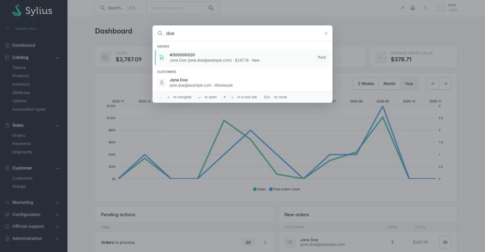

# Sylius Command Palette Plugin

> Français : [README.fr.md](README.fr.md) <!-- vitrine:lang -->

[](https://github.com/thibmonier/sylius-command-palette-plugin/actions/workflows/build.yaml)
[](LICENSE)

**A command palette (Ctrl+K / ⌘K) for the Sylius 2 back office: find any order, customer,
product, promotion or admin page from anywhere.**

The Sylius 2 admin has no global search: the navbar field only searches products, the sidebar
field only filters menu items, and there is no keyboard shortcut. Finding "order 1042" or "the
customer who called" means opening the right grid and filtering it first.

This plugin adds a keyboard-first search dialog to every admin page, free and open source.

## Features

| Need | What the plugin does |
|---|---|
| Open an order from its number | **Orders**: exact number match first, typed as `1042`, `#1042` or `000001042`, then the latest orders of customers whose e-mail or last name starts with the query. Subtitle: customer, total, state; badge: payment state. Carts are never listed. |
| Find a customer | **Customers**: e-mail, first name, last name or phone number prefix, and "first last" (`john do`). Subtitle: e-mail and group. |
| Jump to a product or a variant | **Products**: name in the administrator's language (contains) or code (prefix), then **variants** by code, linked to the product / variant edit page. Disabled products are flagged. |
| Edit a promotion | **Promotions** by name or code, **coupons** by code (linked to the coupons page of their promotion). |
| Navigate without the sidebar | **Pages**: every page of the admin main menu (including the items added by other plugins), with its section, and **actions** (new product, taxon, customer, promotion…). Filtered instantly in the browser from 1 character. |
| Search other data | **Your own sources**: tag a service implementing `SearchProviderInterface`. |

Also included: keyboard navigation, accessible dialog (combobox / listbox pattern, focus trap,
focus restored on close), light and dark themes, translations in English, French, German,
Spanish, Italian, Dutch and Polish, no build step and no JavaScript dependency.

## Screenshots



## Requirements

| | Version |
|---|---|
| PHP | 8.2+ |
| Sylius | 2.2, 2.3 |
| Symfony | 6.4, 7.4, 8.0 |

## Installation

1. Require the package:

    ```bash
    composer require tmonier/sylius-command-palette-plugin
    ```

2. Register the bundle in `config/bundles.php` (Symfony Flex does it automatically once a recipe exists):

    ```php
    Tmonier\SyliusCommandPalettePlugin\TmonierSyliusCommandPalettePlugin::class => ['all' => true],
    ```

3. Import the configuration in `config/packages/tmonier_sylius_command_palette.yaml`:

    ```yaml
    imports:
        - { resource: "@TmonierSyliusCommandPalettePlugin/config/config.yaml" }
    ```

4. Import the admin route in `config/routes/tmonier_sylius_command_palette.yaml`:

    ```yaml
    tmonier_sylius_command_palette:
        resource: "@TmonierSyliusCommandPalettePlugin/config/routes.yaml"
    ```

5. Install the assets (a JavaScript and a CSS file, nothing to build):

    ```bash
    bin/console assets:install
    ```

No migration: the plugin has no table.

## Configuration

```yaml
# config/packages/tmonier_sylius_command_palette.yaml
tmonier_sylius_command_palette:
    limit_per_group: 5      # results per group (1 to 50)
    icons: []               # extra UX Icons names used by your own providers
    providers:
        orders: true
        customers: true
        products: true      # products and variants
        promotions: true    # promotions and promotion coupons
        pages: true         # admin menu pages and "create" actions
    rate_limit:
        enabled: true       # set to false to disable (default: true, requires symfony/rate-limiter)
        per_admin: 120      # max requests per admin user (or per IP) per interval
        interval: '1 minute'
        cache_pool: cache.rate_limiter   # any PSR-6 pool; use a filesystem pool in tests
```

### Rate limiting

The search endpoint runs DQL queries on every keystroke. The built-in rate limiter
(`symfony/rate-limiter` + `symfony/lock`) caps requests at **120 per minute per
admin user** (keyed on the user identifier; falls back to the client IP when no
user is found). Requests that exceed the limit receive a `429 Too Many Requests`
JSON response (`{"error": "too_many_requests"}`) with a `Retry-After` header (seconds).

The rate limiter is enabled by default and is automatically disabled if the
`symfony/rate-limiter` package is not installed. To disable it explicitly:

```yaml
tmonier_sylius_command_palette:
    rate_limit:
        enabled: false
```

## Keyboard shortcuts

| Keys | Action |
|---|---|
| <kbd>Ctrl</kbd>+<kbd>K</kbd> / <kbd>⌘</kbd>+<kbd>K</kbd> | Open / close the palette (from anywhere, even in a form field) |
| <kbd>/</kbd> | Open the palette when the focus is not in a form field |
| <kbd>↑</kbd> <kbd>↓</kbd> | Move between results |
| <kbd>Enter</kbd> | Open the selected result |
| <kbd>Ctrl</kbd>+<kbd>Enter</kbd> / <kbd>⌘</kbd>+<kbd>Enter</kbd> | Open the selected result in a new tab |
| <kbd>Esc</kbd> | Close the palette and return to where you were |

The *Search… ⌘K* button in the navbar opens it too. The Sylius product search field is kept.

## Add your own provider

Implement `SearchProviderInterface` and tag the service with `tmonier_command_palette.provider`.
The priority sets the position of the group (built-in: orders 500, customers 400, products 300,
promotions 200, coupons 100).

```php
namespace App\CommandPalette;

use Doctrine\ORM\EntityManagerInterface;
use Symfony\Component\Routing\Generator\UrlGeneratorInterface;
use Tmonier\SyliusCommandPalettePlugin\Search\LikePattern;
use Tmonier\SyliusCommandPalettePlugin\Search\SearchProviderInterface;
use Tmonier\SyliusCommandPalettePlugin\Search\SearchResult;

final class ShipmentSearchProvider implements SearchProviderInterface
{
    public function __construct(
        private EntityManagerInterface $entityManager,
        private UrlGeneratorInterface $urlGenerator,
    ) {
    }

    public function getKey(): string
    {
        return 'shipments'; // group label: translation "tmonier_command_palette.group.shipments"
    }

    /** $query is trimmed and 2 to 100 characters long. */
    public function search(string $query, int $limit): array
    {
        $rows = $this->entityManager->createQueryBuilder()
            ->select('s.id AS id', 's.tracking AS tracking', 'o.number AS number')
            ->from(\App\Entity\Shipping\Shipment::class, 's')
            ->innerJoin('s.order', 'o')
            ->andWhere(sprintf('LOWER(s.tracking) LIKE :prefix %s', LikePattern::DQL_ESCAPE))
            ->setParameter('prefix', LikePattern::prefix($query)) // escapes % and _
            ->setMaxResults($limit)
            ->getQuery()
            ->getArrayResult();

        return array_map(fn (array $row): SearchResult => new SearchResult(
            title: $row['tracking'],
            subtitle: '#' . $row['number'],
            url: $this->urlGenerator->generate('sylius_admin_shipment_index'),
            icon: 'tabler:truck',
        ), $rows);
    }
}
```

```yaml
# config/services.yaml
services:
    App\CommandPalette\ShipmentSearchProvider:
        arguments: ['@doctrine.orm.entity_manager', '@router']
        tags: [{ name: tmonier_command_palette.provider, priority: 150 }]

# config/packages/tmonier_sylius_command_palette.yaml
tmonier_sylius_command_palette:
    icons: ['tabler:truck']
```

```yaml
# translations/messages.en.yaml
tmonier_command_palette:
    group:
        shipments: Shipments
```

Guidelines:

- Bind every user value as a parameter and escape LIKE wildcards with `LikePattern`
  (`escape()`, `prefix()`, `contains()`, used with `LikePattern::DQL_ESCAPE`).
- Select scalar columns (one query per group, no lazy loading per result) and honour `$limit`.
- Return URLs of admin pages: the endpoint is only available to administrators, but your
  provider decides what it exposes.
- Icons are [UX Icons](https://symfony.com/bundles/ux-icons/current/index.html) names rendered
  once in the layout: add the ones not used by the admin menu to the `icons` option (an
  unknown icon falls back to an arrow).
- An exception thrown by a provider is logged (channel `tmonier_command_palette`) and its group
  is skipped; the other groups are still returned.

Admin menu items added through the `sylius.menu.admin.main` event (or a menu builder) appear
in the *Pages* group automatically.

## Customisation

The admin parts are added with [Twig Hooks](https://stack.sylius.com/twig-hooks/getting-started):

| Hook | Content |
|---|---|
| `sylius_admin.common.component.navbar.menu` → `tmonier_command_palette` | *Search… ⌘K* button (before the product search) |
| `sylius_admin.base#stylesheets` → `tmonier_command_palette` | Stylesheet |
| `sylius_admin.base#javascripts` → `tmonier_command_palette` | Dialog, icons and script (administrators only) |

Templates can be overridden in `templates/bundles/TmonierSyliusCommandPalettePlugin/`. To hide
the navbar button and keep the shortcuts:

```yaml
sylius_twig_hooks:
    hooks:
        'sylius_admin.common.component.navbar.menu':
            tmonier_command_palette:
                enabled: false
```

The search endpoint is `GET /admin/command-palette/search?q=…` (route
`tmonier_command_palette_admin_search`), returning
`{"query": "…", "groups": [{"key", "label", "results": [{"title", "subtitle", "url", "icon", "badge"}]}]}`.

## How it works

- **Server-side search** for orders, customers, products and promotions: requests are
  debounced (200 ms), the previous one is aborted, queries shorter than 2 characters are not
  sent and queries are cut to 100 characters (in the browser and on the server). Each provider runs one or
  two scalar queries with bound parameters, whatever the number of results.
- **Client-side pages**: the admin menu and the actions are rendered once in the page as
  JSON and filtered in the browser, so they appear on the first keystroke.
- **Plain JavaScript, no build**: `command-palette.js` (an IIFE, no dependency) and
  `command-palette.css` are installed by `assets:install` in
  `public/bundles/tmoniersyliuscommandpaletteplugin/`. Every value is rendered with
  `textContent`; icons are cloned from `<template>` elements rendered by Twig.
- **Security**: the endpoint is behind the admin firewall (`ROLE_ADMINISTRATION_ACCESS`, checked
  again in the controller), responses are `private, no-store`. An expired session shows a
  "reload the page" message in the palette.

## Limitations

- Matching uses `LIKE` (prefix for codes, e-mails and names, contains for product and promotion
  names), not a full-text index: on very large catalogues the "contains" searches scan the
  translation tables. Plug a provider backed by your search engine if needed.
- Product names are searched in the administrator's locale only.
- Order numbers are matched exactly; the leading-zero shortcut assumes the default Sylius
  padding (9 digits).
- Sylius Plus RBAC is not integrated: every administrator can find every resource (the pages
  they open still apply their own permissions).
- Catalog promotions, shipments, payments and taxons are not searched in v1 (only reachable as
  pages / actions).

## Development

```bash
docker compose up -d mysql   # or your own MySQL
composer install
(cd vendor/sylius/test-application && yarn install && yarn build)
vendor/bin/console assets:install
vendor/bin/console doctrine:database:create
vendor/bin/console doctrine:migrations:migrate -n
vendor/bin/console sylius:fixtures:load -n

vendor/bin/phpunit --testsuite unit
APP_ENV=test vendor/bin/phpunit --testsuite non-unit   # needs a test database with fixtures
vendor/bin/phpstan analyse
vendor/bin/ecs check
node --check Resources/public/command-palette.js
```

<!-- vitrine:demo-b2b:start -->
## B2B demo

This plugin is used in the [Sylius B2B demo](https://github.com/thibmonier/sylius-b2b-demo): a Sylius 2.3 shop with fictitious sample data where the B2B plugins work together. The source code, setup and fixtures of the demo are in that repository.

The demo is an example, not a production setup.
<!-- vitrine:demo-b2b:end -->

## License

MIT. See [LICENSE](LICENSE).
